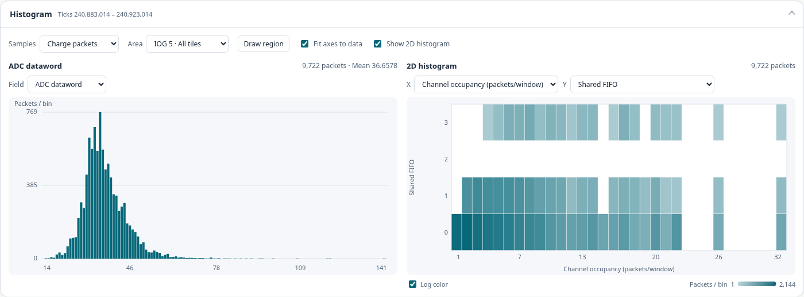

# 2×2 Packet Explorer

Explore ND-LAr 2×2 charge-readout packet files on the eight physical anodes. Select one file or a set of files from different folders. The viewer derives their detector-time coverage and links the map, SYNC/trigger lanes, packet rate and original HDF5 rows to one playhead. One ASIC tick is 100 ns.

## Run on a laptop

Use Python 3.10 or newer. NumPy and h5py are the only runtime dependencies. The browser assets and PacMon geometry ship with the package.

```bash
git clone https://github.com/BrunoGelli/2x2-packet-explorer.git
cd 2x2-packet-explorer
python -m venv .venv
source .venv/bin/activate
python -m pip install .
packet-explorer serve --open --root /path/to/packet/files
```

On Windows PowerShell, activate with `.\.venv\Scripts\Activate.ps1`. You can also open a selection directly. Shell-expanded globs work in shells that support them.

```bash
packet-explorer serve --open file1.h5 file2.h5
```

The selector browses the filesystem of the machine running the reader. Checked files stay selected while navigating between folders. The folder filter and **Select filtered files** support larger selections. When paths are supplied on the command line, their common parent is the default browsing root.

## Run at NERSC

**From the Jupyter web interface**, open **Launcher → Terminal** in the active NERSC JupyterLab server. Activate the Packet Explorer environment, change into the packet directory, and run:

```bash
packet-explorer serve --jupyter --root "$PWD"
```

Open the full HTTPS link printed in that terminal, including the launch key. Jupyter proxies the request back to the automatically selected loopback port on the same node. Leave the command running while exploring. The startup banner prints the server PID, hostname and a ready-to-copy `kill` command. To stop it from a second terminal, run that command on the printed host. Named servers use their own service prefix. Add `--port 8766` to request a particular port.

### From an SSH session

Start the server in an interactive CPU allocation, in an environment where the package is installed. Point it at the parent of the packet directories you need. Project data can remain on the NERSC filesystem.

```bash
hostname
packet-explorer serve --root /path/to/packet --cache-dir "$SCRATCH/2x2-packet-explorer"
```

From the laptop, forward the same port to the allocated node. Substitute your NERSC username and the node name printed by `hostname` for the placeholders.

```bash
ssh -N -J USER@perlmutter.nersc.gov -L 8766:127.0.0.1:8766 USER@COMPUTE_NODE
```

Open the full URL printed by Packet Explorer on the laptop. The reader listens on loopback and its launch URL carries a private key for access to that process. Keep the server and tunnel running while using the viewer. The default port is 8766. Use `--port` and adjust the tunnel if it is occupied. [NERSC compute-node access](https://docs.nersc.gov/jobs/monitoring/)

To index files ahead of time in a batch job, use the same cache directory when opening the viewer.

```bash
packet-explorer index --cache-dir "$SCRATCH/2x2-packet-explorer" /path/to/packet/*.h5
```

## Explore a recording

| Control | Behavior |
| --- | --- |
| **Window** | All mapped charge packets from the trailing window contribute to the map. At playhead tick `t`, the interval is `[max(0, t+1-window), t+1)`. |
| **Step** | Move the playhead by this number of detector ticks, including empty ticks. The left and right arrows step manually. Shift + arrow jumps to the previous or next occupied tick for the selected planes. |
| **Hold** | Keep earlier occupied pixels visible in gray over a trailing detector-time interval. Only packets within **Window** contribute to ADC, FIFO and other statistics. Rewinding reconstructs the same map. |
| **Playback** | Paced playback presents every requested step and waits for each map. Fixed detector-speed playback follows elapsed time and can skip intermediate windows when rendering falls behind. For a contiguous scan, use steps/s with equal window and step widths. Space plays or pauses. |
| **Single tick** | Set window and step to one tick. The hold control stays independently adjustable. Enter an exact tick in the playhead box to seek. |
| **Marker and rate timelines** | Click to seek, drag horizontally to zoom, or use **Zoom in**, **Zoom out** and **Full span**. The bottom overview spans the full selection. The cursor and shaded window follow playback. Dashed lines mark file starts and brown shading marks intervals between recorded coverage spans. |
| **Map visible interval** | Set the map window to exactly the zoomed interval. **First-hit time** colors each pixel by the first hit’s offset from the interval start, in ticks. |
| **Spatial zoom** | Click an IOG heading or double-click its map to expand it. Use the wheel to zoom around a pixel and drag to pan. Use **Fit** for the whole plane or **Fill** to cover the expanded view. The **−** and **+** controls zoom visible planes together. Expand and zoom preserve the timeline selection. Use the **Planes** selector to filter both timelines and map. |
| **Color scale** | For numeric fields, **Full range** uses the field’s hardware range when defined, or zero to the current peak for count, rate and first-hit time. **Window range** uses the minimum and maximum across current active pixels. Held pixels stay gray. **Custom range** keeps fixed limits through playback and clips colors at either end. Each field remembers its settings while the page is open. |
| **Histogram** | Expand the panel below **Packet rate**. **Charge packets** counts every mapped charge packet in the playhead window, with one bin per ADC, FIFO, trigger-type or flag code. **Active map pixels** counts each active pixel once using the current map field and statistic. Held-only pixels are excluded from both. Hover a bin for its exact count. **Fit axes to data** expands the occupied packet-code range in both plots. |
| **2D histogram** | Choose X and Y in the plot beside the histogram. Color gives the number of samples in each bin. Blank cells contain zero samples. **Log color** helps reveal rare combinations, and can be switched off for a linear scale. Hover for its exact ranges and count. Both plots share the time window and area. The **Show 2D histogram** checkbox switches the extra calculation off. |
| **Channel occupancy vs FIFO** | In **Charge packets**, X defaults to the number of packets from that physical channel in the window and Y to the packet’s local FIFO code. Choose **Channel ID** to group by the electronics channel number (0–63) across selected chips. In **Active map pixels**, each active pixel contributes once. To compare channel occupancy with median FIFO, set the anode map to **Local FIFO → Median** and use **Current map value** as Y. |
| **Histogram area** | Choose the selected planes, an IOG, or one tile. For a custom area, click **Draw region**, then drag a rectangle on one IOG. It can cross tile boundaries. Its dashed outline stays attached to the selected pixels through pan, zoom and playback. Changing the clock or the global planes filter resets the area. |
| **Theme** | Choose **Light**, **Dark** or **System** in the header. The browser remembers the preference. |
| **Map and inspector** | Hover a pixel to read its IOG, tile, chip ID and channel below the map, including on quiet pixels. Click a physical pixel to page through its contributing packet rows. Click a table row for the complete recorded fields. **Source rows** gives direct access to every input row, including configuration, timestamps, unmapped addresses and rejected packets. |

**To examine a WAT**, find a rate spike and drag across it. Enable **Active chips / bin** to see how much of the detector participates. Select **Map visible interval → First-hit time** to see the spatial onset. Open **Histogram**, choose **Charge packets → ADC dataword**, and draw a region around the footprint to inspect its spectrum. Then use **Single tick** and set **Hold** to e.g. 10 µs to watch the footprint accumulate across 100 cycles. **Peak rate** seeks to the first occupied tick in the highest-rate visible bin. A selection initially opens at the peak of its overview.



**Pixel fields** include occupancy, count, rate, first-hit time, ADC dataword, local/shared FIFO state, trigger type, first-packet flag and downstream marker. Value fields offer latest, mean, exact median, minimum and maximum. FIFO states also offer the fraction of contributing packets reporting full (code 3). A numeric zero and an empty pixel have distinct colors. Raw diagnostic FIFO counts remain available in the source inspector.

## Timing and coverage

- Input is a closed LArPix ASIC v2 packet HDF5 file with a flat `/packets` dataset (formats 2.3 / 2.4). The reader opens inputs read-only.
- The index unrolls timestamps independently per IOG in recorded order and then sorts each bounded block. Sorting after unrolling preserves out-of-order hits. Each valid SYNC-83 advances by its recorded interval rounded to the nearest multiple of 10 million ticks. A receipt before the raw ASIC timestamp applies the previous reset interval correction. Ticks 0–9 are included.
- Whole-second anchors use the preceding type-4 software timestamp for each reset. A detector-wide stream requires at least two consistent labelled resets and no invalid reset. The absolute clock is a PPS/header-labelled estimate. Integer ticks stay exact for navigation. UTC is displayed to milliseconds. Marker lanes retain the recorded IOG and subtype for triggers. SYNC lanes group by subtype and can be filtered by IOG.
- A stream with conflicting or insufficient anchors can be inspected on its file-local IOG clock when it has indexable ticks. **File and timing details** lists per-IOG counts. The map and rate use the same population of timing-valid, parity-valid, geometry-mapped ordinary charge packets. Pre-first-SYNC rows and FIFO-diagnostic timestamps remain available in source order. Any late packets the reader can place across a qualified reset are included.
- Duplicate selections of the same resolved path count once. Files keep independent clock state and source-row identities. Disjoint time coverage retains its gaps. Overlapping distinct files are flagged and both sets of records contribute. Timing-qualified coverage can start later than a file's first raw row. A file with no qualified view can still be opened in **Source rows**.

## Cache and performance

The reader makes one chunked HDF5 pass per new file. It writes sorted runs containing the local tick, pixel, source row and common display fields. Range queries binary-search memory-mapped runs. Only requested rate bins, clustered markers, active/held pixels or a page of original rows go to the browser. Large-window exact medians use a bounded per-anode histogram. Each cache entry is published atomically and keyed by resolved path, size, modification time and index format.

The cache defaults to `$SCRATCH/2x2-packet-explorer` in a NERSC environment and the user's cache directory elsewhere. Cache entries can be removed after closing the server.

### Real-file verification

The interactive viewer was exercised in Chromium with two consecutive Run 0070043 files covering 241.66 detector seconds and 13,378,894 source rows. The supplied `23_24_27_CST` file contains 6,590,716 rows, including 4,345,005 mapped charge packets, 960 SYNC-83 markers, 96 SYNC-72 markers and 342 trigger markers. A direct HDF5 check of a 5 ms interval reproduced all 100 selected row IDs and all 87 pixel ADC medians using the original PacMon coordinates.

On the development machine, the supplied 239 MB file took about 3.7 s to index and used about 104 MB of cache. A cached whole-file rate/marker query took about 25 ms. A full-file exact ADC median map took about 1.5 s. These backend observations exclude browser rendering and remote network latency. [Test recording](https://portal.nersc.gov/project/dune/data/2x2/nearline_run3/packet/Operations/20261106-LowIntensityBeam_LRSselfTrigger_Physics/packet-0070043-2026_11_06_23_24_27_CST.h5)

## Development

```bash
python -m pip install -e '.[test]'
python -m pytest -q
```

For the optional headless browser test, install the Python `playwright` package and set `PACKET_EXPLORER_BROWSER` to an installed Chromium or Chrome Headless Shell executable. The test starts and stops its own loopback server.

See [NOTICE.md](NOTICE.md) for geometry provenance and rebuild instructions.
